<div align="center">

# Orrery

**A living, 3D observatory for your Proxmox homelab.**

Every VM and container becomes a brass instrument in orbit around your host. It glows with CPU, rings with memory, trails network traffic, and turns red the moment something needs you.

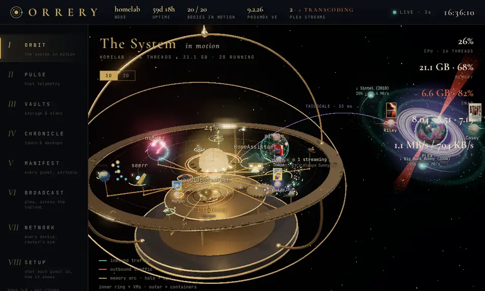

</div>

---

## Why

Proxmox's own UI tells you everything, in tables. Orrery tells you the same things at a glance, and adds what the services themselves know: who's streaming, what Pi-hole is blocking, which backup is running, who just walked in the door.

- **It figures out your lab by itself.** Point it at Proxmox and it finds each guest's address, checks what answers on it, and recognises **44 popular self-hosted services** by their own web pages and APIs.
- **Things that matter are big.** Services you actually watch are drawn large and bright. Background workers stay small and dim, and sentinels like Uptime Kuma and backups light up only when something goes wrong.
- **Hover anything for the detail that matters for that service**, not just CPU and memory.
- **Read-only.** Orrery uses a Proxmox `PVEAuditor` token. It can't start, stop or change anything.
- **No dependencies.** The server is a single Python 3 process using only the standard library. The frontend is plain JavaScript and [three.js](https://github.com/mrdoob/three.js), vendored.

## Watch it work

Services aren't just dots. Each one acts out what it's doing.

<table>
<tr>
<td width="50%">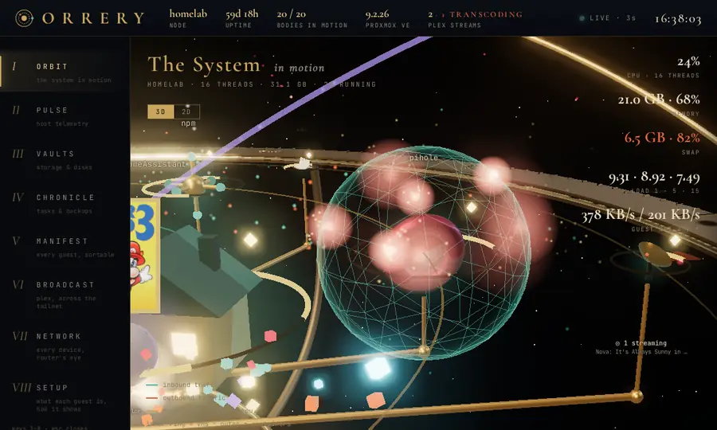<br><b>Pi-hole</b>: every blocked query is a spark shot down at the shield, with the domain and the device that asked.</td>
<td width="50%">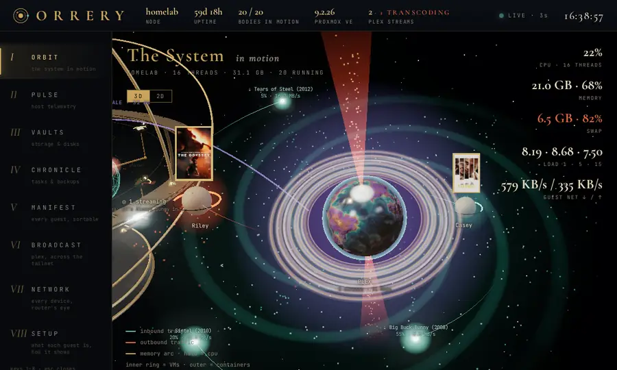<br><b>Downloads</b>: torrents swirl into the media giant as comets. When one finishes, it lands with a shockwave ring.</td>
</tr>
<tr>
<td colspan="2">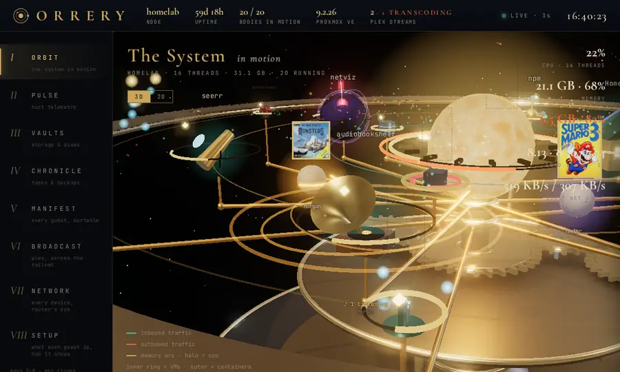<br><b>Listening and playing</b>: someone in Audiobookshelf or a game running in RomM becomes a moon, carrying the cover of what they're on.</td>
</tr>
</table>

### Hover cards

<table>
<tr>
<td width="33%">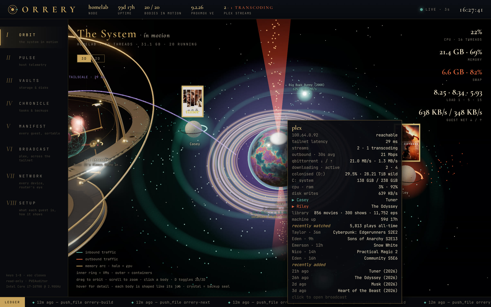<br><b>Plex</b>: who's streaming what, transcodes, bandwidth.</td>
<td width="33%">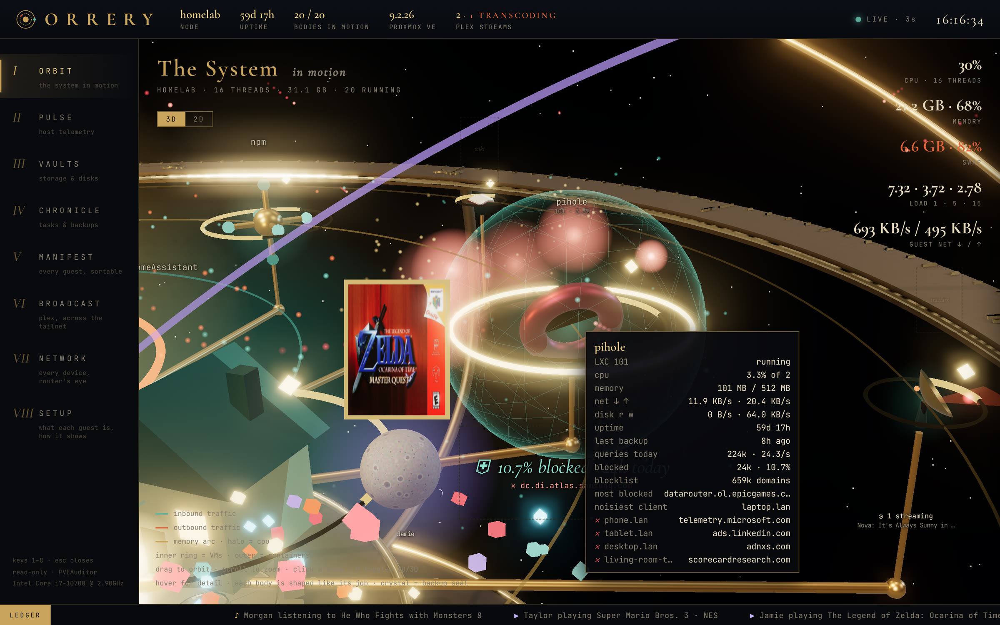<br><b>Pi-hole</b>: block rate, latest blocks, noisiest clients.</td>
<td width="33%">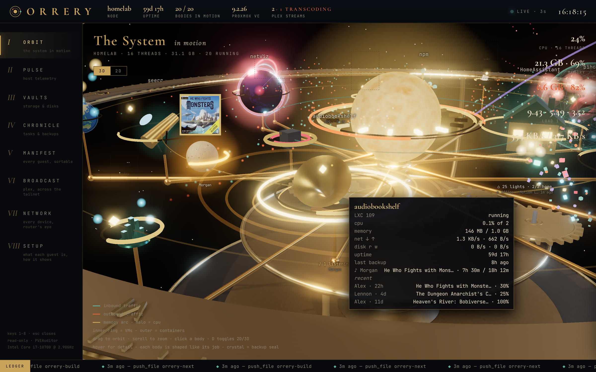<br><b>Audiobookshelf</b>: who's listening, how far in.</td>
</tr>
<tr>
<td>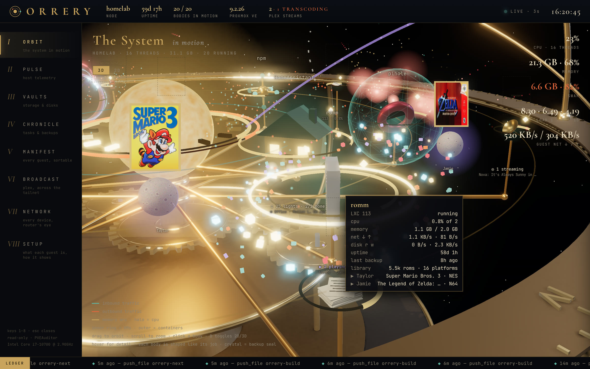<br><b>RomM</b>: library size and what's being played.</td>
<td>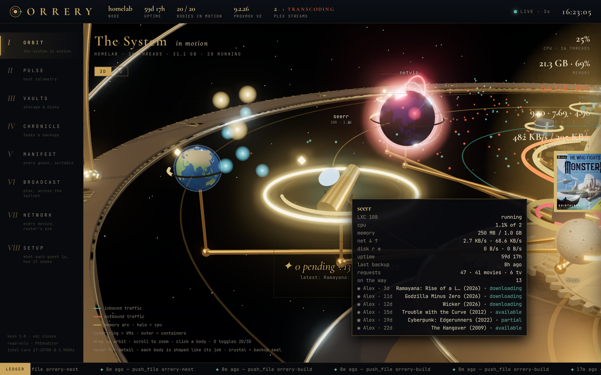<br><b>Seerr</b>: recent requests and their status.</td>
<td>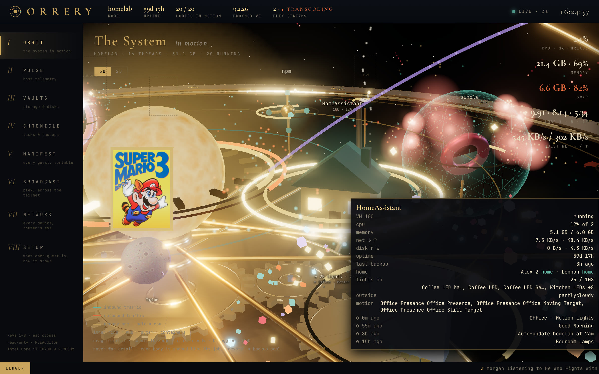<br><b>Home Assistant</b>: who's home, lights on, alerts.</td>
</tr>
</table>

<sub>All screenshots come from a real lab. Names, addresses, hostnames and locations are replaced with stand-ins, photos are left out, and some activity (the downloads, listeners and players) is staged so there's something to see.</sub>

## A tour

<table>
<tr>
<td width="50%">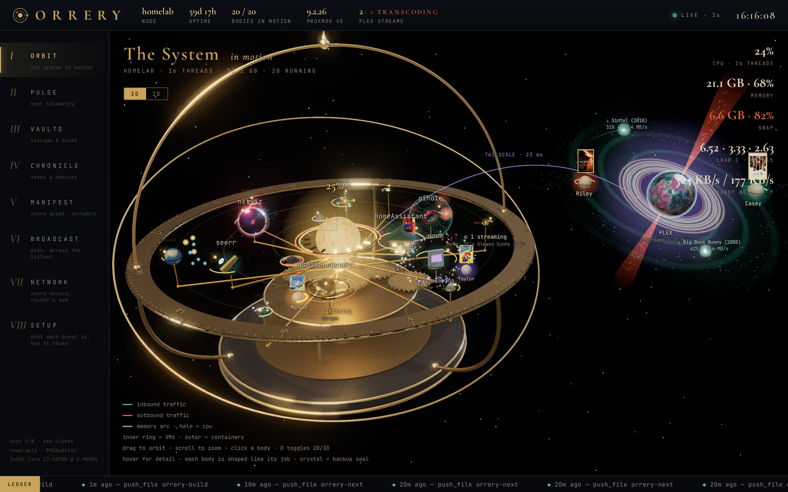<br><b>Orbit</b>: the whole system in motion. Prominent services on the middle ring, background ones further out.</td>
<td width="50%">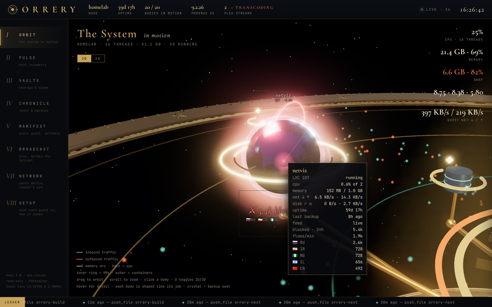<br><b>Hover cards</b>: service-specific detail. Here, <a href="https://github.com/pyro262/netviz">NetViz</a> showing where blocked traffic came from.</td>
</tr>
<tr>
<td>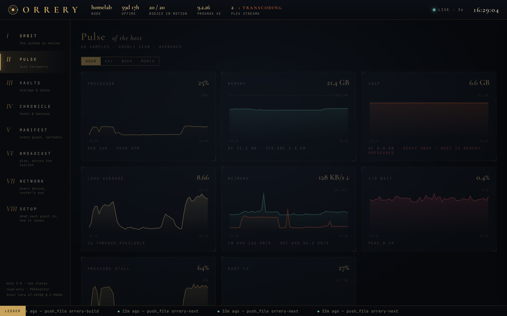<br><b>Pulse</b>: host CPU, memory, swap, load, network and disk I/O, by hour, day, week or month.</td>
<td>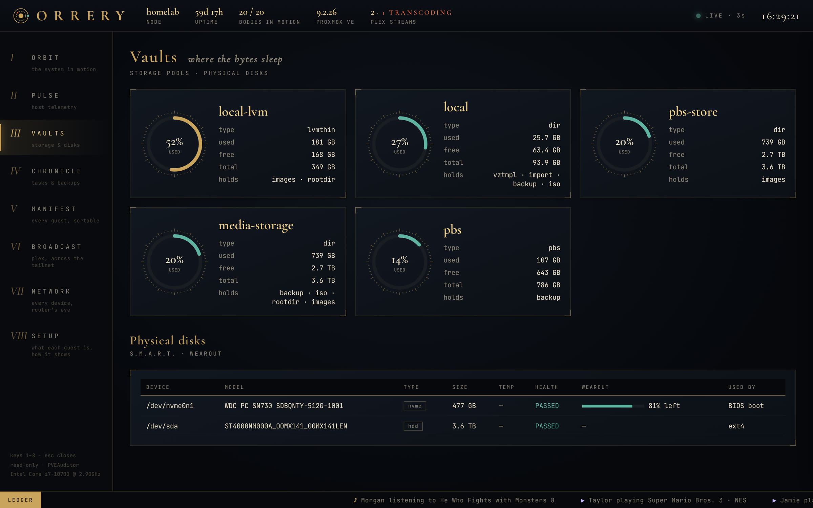<br><b>Vaults</b>: storage pools and physical disks, with SMART health and wear.</td>
</tr>
<tr>
<td>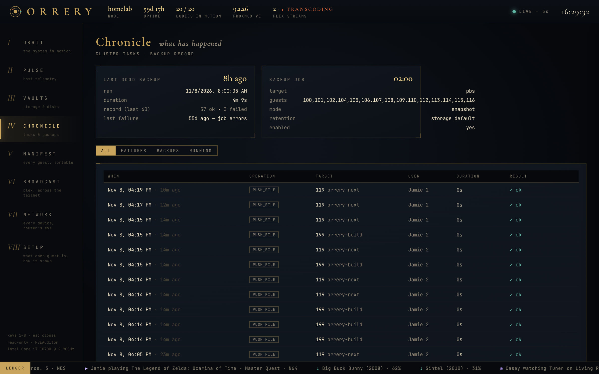<br><b>Chronicle</b>: every task and backup run, newest first, with your backup record at a glance.</td>
<td>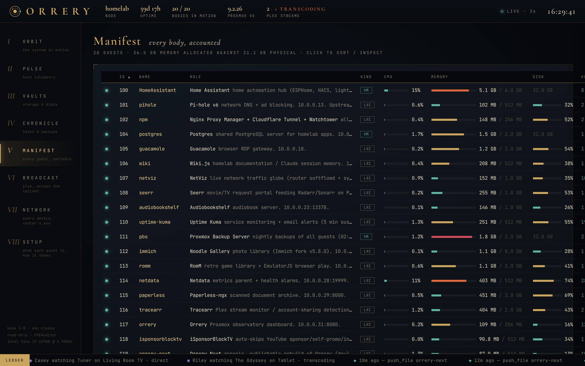<br><b>Manifest</b>: every guest in one sortable table, with its role taken from its Proxmox notes.</td>
</tr>
</table>

## Setup that does the work for you

The first time you open Orrery, a wizard walks you through it. Nothing to edit by hand.

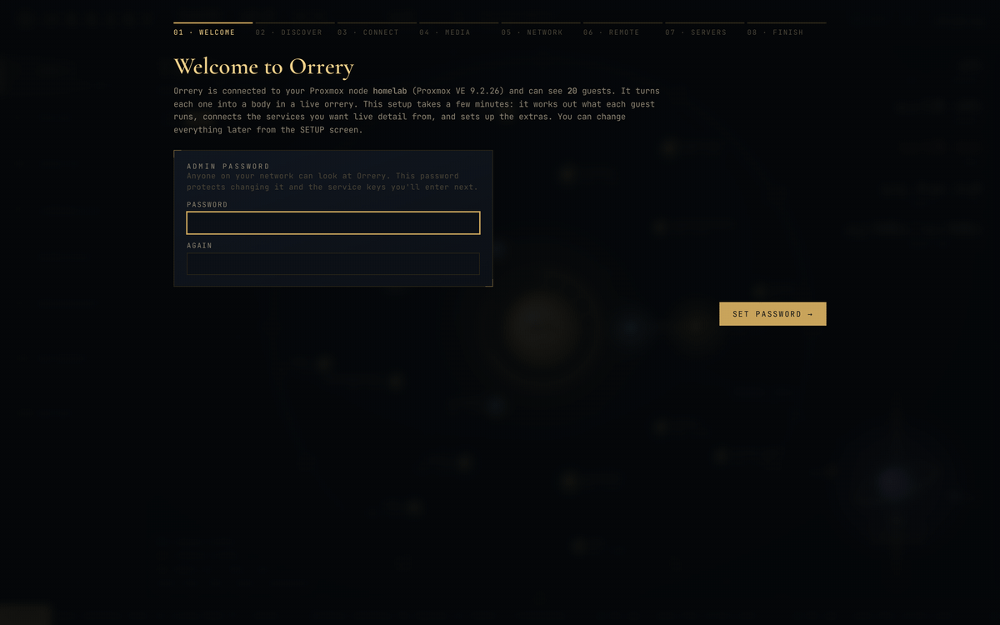

1. **Set an admin password.** Anyone on your network can look; only you can change things.
2. **Discover.** Orrery shows what it found, grouped into *Identified*, *Best guesses* and *Not recognised*, with the evidence for each ("answers like Pi-hole on :80/admin/"). Correct anything, or set a guest to a plain planet.
3. **Connect services.** For each service with live detail, the address is already filled in. Paste the key (the card says exactly where to find it) and press **Test** for a plain-English result: *"Connected: 47 requests so far"*, or *"Reached it, but the key was rejected."*
4. **Media world.** Plex, Jellyfin or Emby can be a giant planet of its own, with streams orbiting as moons, wherever it runs: on this host, another machine, or across Tailscale.
5. **Network traffic, remote access, more servers.** Optional, and all revisitable later.

Everything the wizard sets lives on the **Setup** screen afterwards. Services still waiting on an API key are highlighted, and adding one is a click away.

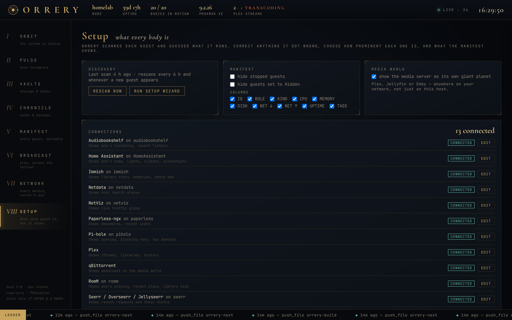

## Supported services

Orrery recognises these by name, Proxmox tags, open ports and, most reliably, by what their web page or API says. Anything it doesn't recognise still gets a planet, and you can assign it one of these looks by hand.

**Live detail** means Orrery can show the service's own data once you give it a key. *Host agent* items need the optional agent on the Proxmox host (see [Roadmap](#roadmap)).

**Media**

| Service | Live detail | Looks like | Default |
|---|---|---|---|
| [Plex](https://www.plex.tv) | streams, libraries, history (giant planet) | telescope | Prominent |
| [Jellyfin](https://github.com/jellyfin/jellyfin) | giant planet; live stats soon | telescope | Prominent |
| [Emby](https://emby.media) | giant planet; live stats soon | telescope | Prominent |
| [Seerr](https://github.com/seerr-team/seerr) | recent requests | telescope | Prominent |
| [Audiobookshelf](https://github.com/advplyr/audiobookshelf) | who's listening, recent listens | gramophone | Prominent |
| [Navidrome](https://github.com/navidrome/navidrome) | — | gramophone | Prominent |
| [Sonarr](https://github.com/Sonarr/Sonarr) | — | radar dish | Background |
| [Radarr](https://github.com/Radarr/Radarr) | — | radar dish | Background |
| [Prowlarr](https://github.com/Prowlarr/Prowlarr) · [Jackett](https://github.com/Jackett/Jackett) | — | radar dish | Background |
| [qBittorrent](https://github.com/qbittorrent/qBittorrent) | downloads on the media world | radar dish | Background |
| [Transmission](https://github.com/transmission/transmission) | — | radar dish | Background |
| [Tracearr](https://github.com/connorgallopo/tracearr) · [Tautulli](https://github.com/Tautulli/Tautulli) | streams today, sharing alerts | radar dish | Background |
| [Immich](https://github.com/immich-app/immich) · [Noodle Gallery](https://github.com/open-noodle/gallery) | library, memories, photo map | globe | Background |
| [iSponsorBlockTV](https://github.com/dmunozv04/iSponsorBlockTV) | — | planet | Hidden |

**Games**

| Service | Live detail | Looks like | Default |
|---|---|---|---|
| [RomM](https://github.com/rommapp/romm) | who's playing, recent plays | cartridge | Prominent |

**Network**

| Service | Live detail | Looks like | Default |
|---|---|---|---|
| [Pi-hole](https://github.com/pi-hole/pi-hole) | queries, blocking rate, top domains | black hole | Prominent |
| [AdGuard Home](https://github.com/AdguardTeam/AdGuardHome) | — | black hole | Prominent |
| [Nginx Proxy Manager](https://github.com/NginxProxyManager/nginx-proxy-manager) | requests per service *(host agent)* | switchyard | Prominent |
| [Traefik](https://github.com/traefik/traefik) | — | switchyard | Prominent |
| [Caddy](https://github.com/caddyserver/caddy) | — | switchyard | Prominent |
| [NetViz](https://github.com/pyro262/netviz) | live traffic globe | globe | Prominent |
| [Tailscale](https://github.com/tailscale/tailscale) · [Headscale](https://github.com/juanfont/headscale) · [wg-easy](https://github.com/wg-easy/wg-easy) | — | switchyard | Background |

**Home automation**

| Service | Live detail | Looks like | Default |
|---|---|---|---|
| [Home Assistant](https://github.com/home-assistant/core) | who's home, lights, climate, automations | house | Prominent |
| [Frigate](https://github.com/blakeblackshear/frigate) | — | CRT | Prominent |
| [Zigbee2MQTT](https://github.com/Koenkk/zigbee2mqtt) | — | house | Background |
| [Mosquitto](https://github.com/eclipse-mosquitto/mosquitto) · [EMQX](https://github.com/emqx/emqx) | — | switchyard | Background |
| [Node-RED](https://github.com/node-red/node-red) | — | cog | Background |

**Storage**

| Service | Live detail | Looks like | Default |
|---|---|---|---|
| [Nextcloud](https://github.com/nextcloud/server) | — | paper stack | Prominent |
| [TrueNAS](https://www.truenas.com) · [OpenMediaVault](https://github.com/openmediavault/openmediavault) | — | safe | Sentinel |
| [Syncthing](https://github.com/syncthing/syncthing) | — | paper stack | Background |

**Documents**

| Service | Live detail | Looks like | Default |
|---|---|---|---|
| [Paperless-ngx](https://github.com/paperless-ngx/paperless-ngx) | documents, recent scans | paper stack | Background |
| [Wiki.js](https://github.com/requarks/wiki) · [BookStack](https://github.com/BookStackApp/BookStack) | recent edits *(host agent)* | open book | Background |

**Security**

| Service | Live detail | Looks like | Default |
|---|---|---|---|
| [Vaultwarden](https://github.com/dani-garcia/vaultwarden) | — | safe | Background |
| [authentik](https://github.com/goauthentik/authentik) · [Authelia](https://github.com/authelia/authelia) · [Keycloak](https://github.com/keycloak/keycloak) | — | safe | Background |

**Monitoring**

| Service | Live detail | Looks like | Default |
|---|---|---|---|
| [Uptime Kuma](https://github.com/louislam/uptime-kuma) | monitors that are down | beating heart | Sentinel |
| [Netdata](https://github.com/netdata/netdata) | health alarms | bar chart | Sentinel |
| [Grafana](https://github.com/grafana/grafana) · [Prometheus](https://github.com/prometheus/prometheus) | — | bar chart | Background |

**Infrastructure**

| Service | Live detail | Looks like | Default |
|---|---|---|---|
| [Apache Guacamole](https://guacamole.apache.org) | open remote sessions *(host agent)* | CRT | Hidden |
| [Proxmox Backup Server](https://www.proxmox.com/en/products/proxmox-backup-server/overview) | backup progress, last good backup per guest | safe | Sentinel |
| [PostgreSQL](https://www.postgresql.org) · [MariaDB](https://mariadb.org) · [Redis / Valkey](https://valkey.io) | — | database stack | Background |
| [Portainer](https://github.com/portainer/portainer) · [Dockge](https://github.com/louislam/dockge) · [Komodo](https://github.com/moghtech/komodo) | — | cog | Background |
| [Homepage](https://github.com/gethomepage/homepage) · [Homarr](https://github.com/homarr-labs/homarr) · [Dashy](https://github.com/lissy93/dashy) | — | CRT | Hidden |

**Development**

| Service | Live detail | Looks like | Default |
|---|---|---|---|
| [Gitea](https://github.com/go-gitea/gitea) · [Forgejo](https://codeberg.org/forgejo/forgejo) | — | cog | Background |

**AI**

| Service | Live detail | Looks like | Default |
|---|---|---|---|
| [Ollama](https://github.com/ollama/ollama) · [Open WebUI](https://github.com/open-webui/open-webui) | — | armillary sphere | Prominent |

> Missing your favourite? Each service is a few lines of JSON in [`templates.json`](templates.json); see [Adding a service](#adding-a-service).

## Install

> A one-line installer is on the way. Until then, setup takes about ten minutes by hand.

**You need:** Proxmox VE 8 or 9, and a small Debian 12 container for Orrery (1 core, 512 MB, 4 GB disk is plenty) on the same network as your guests. The 3D view needs a browser with WebGL2; there's a 2D view otherwise.

**1. Create a read-only API token** (on the Proxmox host shell):

```sh
pveum user add orrery@pve --comment "Orrery dashboard (read-only)"
pveum acl modify / --users orrery@pve --roles PVEAuditor
pveum user token add orrery@pve dash --privsep 0
```

Keep the token secret it prints; Proxmox shows it only once.

**2. Install Orrery** (inside the Debian container):

```sh
apt update && apt install -y git python3
git clone https://github.com/prognar/orrery.git /opt/orrery
useradd -r -s /usr/sbin/nologin orrery
mkdir -p /opt/orrery/data
cp /opt/orrery/deploy/config.example.json /opt/orrery/data/config.json
nano /opt/orrery/data/config.json        # your Proxmox address, node name and token
chown -R orrery:orrery /opt/orrery && chmod 640 /opt/orrery/data/config.json
cp /opt/orrery/deploy/orrery.service /etc/systemd/system/
systemctl enable --now orrery
```

**3. Open `http://<container-ip>:8080`** and follow the wizard.

To update: `cd /opt/orrery && git pull && systemctl restart orrery`. Your settings and keys live in `data/`, which updates never touch.

## Security and privacy

- **Read-only to Proxmox.** The `PVEAuditor` role can read status, config and task logs, and nothing else.
- **Your keys stay put.** Service keys are stored in `data/secrets.json` (mode `0600`) on the Orrery container and are only ever sent to the service they belong to. They're never shown back in the browser.
- **Admin password.** Changing anything needs it; it's stored as a salted PBKDF2 hash. Until it's set on first run, whoever opens Orrery first can set it, as with most self-hosted apps, so finish setup soon after installing.
- **Gentle discovery.** Orrery checks a short list of ports per guest, four at a time, and always completes each HTTP request it opens. Some small embedded web servers misbehave when connections are opened and abandoned, so it never does that.
- **Nothing phones home.** No telemetry, no external requests except to the services you connect.

## Adding a service

A template is a few lines in [`templates.json`](templates.json):

```json
{"key": "navidrome", "label": "Navidrome", "category": "media", "look": "gramophone", "tier": "active", "trait": null,
 "match": {"names": ["navidrome"], "ports": [4533],
           "http": [{"port": 4533, "path": "/app/", "re": "<title>[^<]*Navidrome"}]}}
```

- `match.http` is the strongest signal: a path to fetch and a regex that only that service's page would match. Anchor it to `<title>` where you can, so a page that merely *mentions* the service doesn't match.
- `look` is one of: `house`, `dbstack`, `vault`, `blackhole`, `junction`, `monitor`, `book`, `telescope`, `gramophone`, `heart`, `cartridge`, `barchart`, `papers`, `radar`, `cog`, `armillary`, `globe`, `generic`.
- `tier` is the default prominence: `active` (prominent), `watch` (sentinel), `quiet` (background) or `hidden`.

Live detail (a hover card and wizard entry) is a small Python fetcher plus a credential spec; see `app/wizard.py` for examples. Pull requests very welcome.

## Roadmap

- [ ] One-line installer that creates the container, the API token and the service
- [ ] Multiple Proxmox servers, each its own orrery you can switch between (servers can already be added)
- [ ] Network traffic sources: DNS-only (Pi-hole / AdGuard), OPNsense / pfSense, UniFi, NetFlow / sFlow
- [ ] Tailscale joining from the wizard
- [ ] Live stats for Jellyfin and Emby, Sonarr / Radarr, AdGuard Home
- [ ] Optional host agent (CPU and disk temperatures, proxy request flow, remote-desktop sessions), opt-in

## Credits

- [**NetViz**](https://github.com/pyro262/netviz) by [pyro262](https://github.com/pyro262): the live network-traffic globe that Orrery's network body is built around. If you like seeing where your traffic goes, go give it a star.
- [three.js](https://github.com/mrdoob/three.js) for the 3D, and [Blender](https://www.blender.org) for the brass.
- Every project in the table above, for making self-hosting this good.

## License

Orrery is free software under the [GNU Affero General Public License v3.0](LICENSE).

In plain terms: use it, change it, add your own planets and send them back. If you share a modified Orrery, or run one for other people over a network, you have to share your source under the same license. Nobody gets to take it closed.

Bundled [three.js](https://github.com/mrdoob/three.js) is MIT-licensed ([notice](app/static/vendor/three/LICENSE)). Service names and logos belong to their projects.
